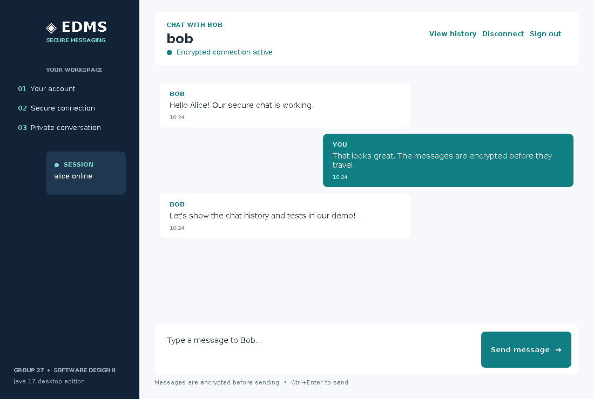

# EDMS Testing Evidence

**Test date:** 26 October 2026  
**Environment:** OpenJDK 17.0.20, Linux, Java standard library  
**Command:** `bash scripts/test.sh`  
**Observed outcome:** **23 PASS / 0 FAIL**, including real localhost socket/handshake tests and Swing layout rendering performed with permitted socket access.

## 1. Normal and edge-case test matrix

| ID | Type | Input/action | Expected result | Observed |
|---|---|---|---|---|
| T01 | Normal | Register `alice` / `password123` | Account created | PASS |
| T02 | Edge | Register `alice` twice | Duplicate rejected | PASS |
| T03 | Invalid | Register `A!` | Username rejected | PASS |
| T04 | Boundary | Password `123` | Too-short password rejected | PASS |
| T05 | Normal | Correct Alice login | Login permitted | PASS |
| T06 | Invalid | Incorrect password and unknown username | Both rejected | PASS |
| T07 | Persistence | Reopen account store then log in | Login still works | PASS |
| T08 | Security | Same passwords for two accounts | No plaintext, different salted hashes | PASS |
| T09 | Normal | AES-GCM with Unicode `🔐`, `🇿🇦` | Decrypted text exactly matches | PASS |
| T10 | Security | Encrypt the same text twice | Ciphertexts differ (random nonces) | PASS |
| T11 | Invalid | `Not-base64!!` ciphertext | Checked rejection, no crash | PASS |
| T12 | Security | Flip one ciphertext byte | Authentication failure | PASS |
| T13 | Security | Decrypt with wrong passphrase | Authentication failure | PASS |
| T14 | Normal | Message with pipes, tab, Unicode | Message metadata/content preserved | PASS |
| T15 | Boundary | Blank, 2,001 and 2,000-character messages | First two rejected; last accepted | PASS |
| T16 | Invalid | Incomplete fields and bad sender | Message rejected | PASS |
| T17 | Normal | Save and reload private history | Message recovered; plaintext absent from file | PASS |
| T18 | Recovery | Append corrupted history and try wrong key | Good entry readable; invalid entries skipped | PASS |
| T19 | Integration | Loopback `PING`/`PONG`, then disconnect | Both directions succeed; EOF detected | PASS |
| T20 | Invalid | Port `70000`, incomplete client args | Helpful validation failures | PASS |
| T21 | Integration | Two-peer AES-GCM hello and encrypted message | Both peer identities and encrypted message verified | PASS |
| T22 | Security | Two peers use different shared passphrases | Both authenticated handshakes rejected | PASS |
| T23 | GUI | Render Swing `ChatPanel` while headless | 1100×740 screenshot with visible sidebar and chat panels | PASS |

The test program uses assertions and exits with non-zero status if any case fails; a printed `PASS` is not a manually assigned label.

## 2. Full automated test output (observed)

```text
Build successful (Java 17).
PASS T01 | normal registration succeeds
PASS T02 | duplicate registration safely rejected
PASS T03 | invalid username rejected
PASS T04 | short password rejected
PASS T05 | correct login succeeds
PASS T06 | incorrect and absent logins rejected
PASS T07 | user accounts survive restart
PASS T08 | credential storage has salt, not plaintext
PASS T09 | AES-GCM round trip incl. Unicode
PASS T10 | random nonce changes ciphertext
PASS T11 | malformed ciphertext rejected
PASS T12 | tampered authenticated ciphertext rejected
PASS T13 | wrong shared passphrase rejected
PASS T14 | message serialization survives punctuation and Unicode
PASS T15 | blank/oversize messages rejected; exact limit accepted
PASS T16 | malformed message fields rejected
PASS T17 | encrypted history save and reload
PASS T18 | wrong history key and corrupt entry handled
PASS T19 | network loopback transfer and disconnect
PASS T20 | invalid CLI ports and incomplete args rejected
PASS T21 | encrypted two-peer handshake and chat frame
PASS T22 | mismatched peer passphrases abort handshake
PASS T23 | Swing chat view renders a GUI preview headlessly
----------------------------------------
RESULT: 23 passed, 0 failed (23 cases)
```

During the first (earlier console-version) run in a restricted execution sandbox, T19 could not bind to localhost (`Operation not permitted`). The tests were rerun in a permitted localhost environment and passed. With the new GUI/handshake tests added, the latest authorized run returned **23/23**. A standard desktop environment is needed to click through the GUI itself; T23 verifies actual Swing layout rendering without a display.

## 3. Live two-terminal functional demo (observed)

Actual integration run used **Alice as server** and **Bob as client** with port `8891`, a throwaway `demo-data` directory, and the same manually entered shared passphrase. Both users were registered through the app UI in their respective windows.

**Terminal A (Alice/server):**

```text
Registration successful.
Signed in as alice.
Waiting for peer on localhost:8891 ...
Encrypted connection ready: alice <-> bob
Type a message, /history, /help or /quit.
> Hello Bob, this is Alice 🔐
[Sent securely to bob]
> 
[2026-10-26T13:16:04.507736359Z] bob: Hi Alice, encryption works ✅
> /history
--- Encrypted local chat history (decrypted for signed-in user) ---
[2026-10-26T13:15:53.030735683Z] SENT alice -> bob: Hello Bob, this is Alice 🔐
[2026-10-26T13:16:04.507736359Z] RECEIVED bob -> alice: Hi Alice, encryption works ✅
> /quit
Logged out. EDMS shutdown complete.
```

**Terminal B (Bob/client):**

```text
Registration successful.
Signed in as bob.
Connecting to localhost:8891 ...
Encrypted connection ready: bob <-> alice
Type a message, /history, /help or /quit.
> 
[2026-10-26T13:15:53.030735683Z] alice: Hello Bob, this is Alice 🔐
> Hi Alice, encryption works ✅
[Sent securely to alice]
> /history
--- Encrypted local chat history (decrypted for signed-in user) ---
[2026-10-26T13:15:53.030735683Z] RECEIVED alice -> bob: Hello Bob, this is Alice 🔐
[2026-10-26T13:16:04.507736359Z] SENT bob -> alice: Hi Alice, encryption works ✅
> /quit
Logged out. EDMS shutdown complete.
```

The original console stream contained extra prompt redraws when incoming and typed text overlapped; the transcript above omits those prompt-only artifacts. No message content was changed.

## 4. Evidence-to-requirement summary

| Requirement | Demonstration/test evidence |
|---|---|
| Account management | Registration in both terminals; T01–T08 |
| Two-way messaging | Alice → Bob and Bob → Alice live transcripts; T19 |
| Encryption and authentication tags | T09–T13 and full encrypted handshake T21–T22; AES-GCM implementation |
| Encrypted local history | `/history` on both terminals; T17, T18 |
| Usability and errors | T02–T04, T15–T16, T20, `/help` and `/quit` |
| Graceful socket close | Both live sessions exited normally; T19 |
| Desktop GUI layout | T23 image rendering and `docs/GUI_PREVIEW.png` |

## 5. New Swing GUI preview evidence



This preview was produced by `java -Djava.awt.headless=true -cp out EdmsGui --preview docs/GUI_PREVIEW.png` using the same `ChatPanel` component as the application. It is **not** evidence of clicking through a live desktop session. Registration, connection controls and chat interactions must be rehearsed on the group's Windows/NetBeans laptop before submission.

## 6. Known untested or future scenarios

These results do **not** prove independent remote identity, resistance to replay or distributed denial-of-service, cross-machine operation, persistence after simultaneous account updates by separate processes, many-to-many messaging, or production security. These are listed as future work in the software design report. A lecturer may ask for screenshots on the group's own laptop; capture those during the final rehearsal using the supplied demo script.
