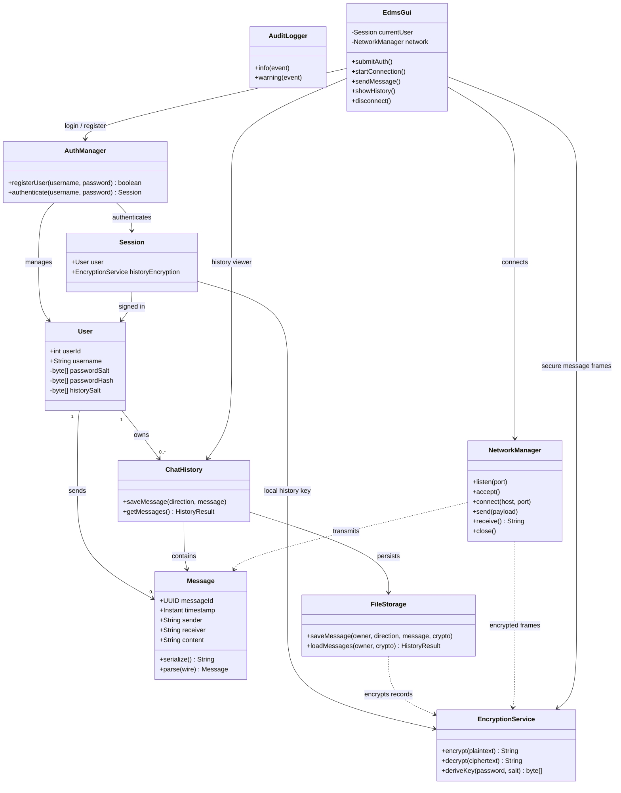
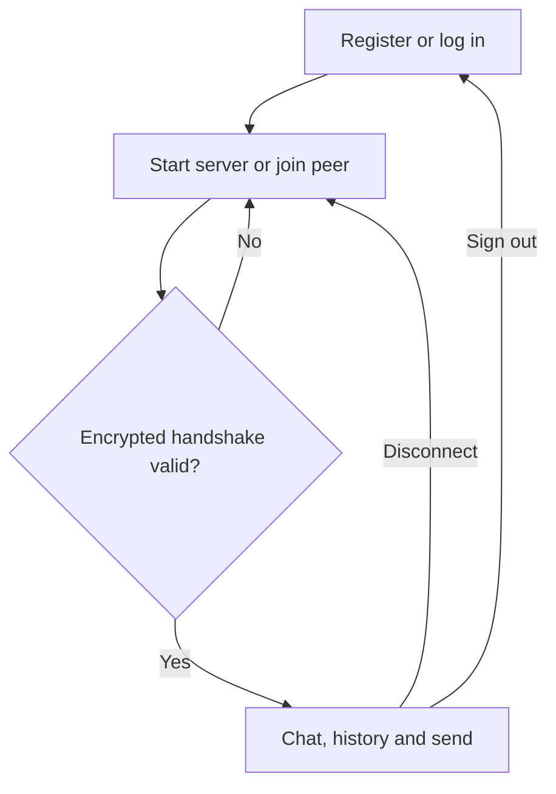
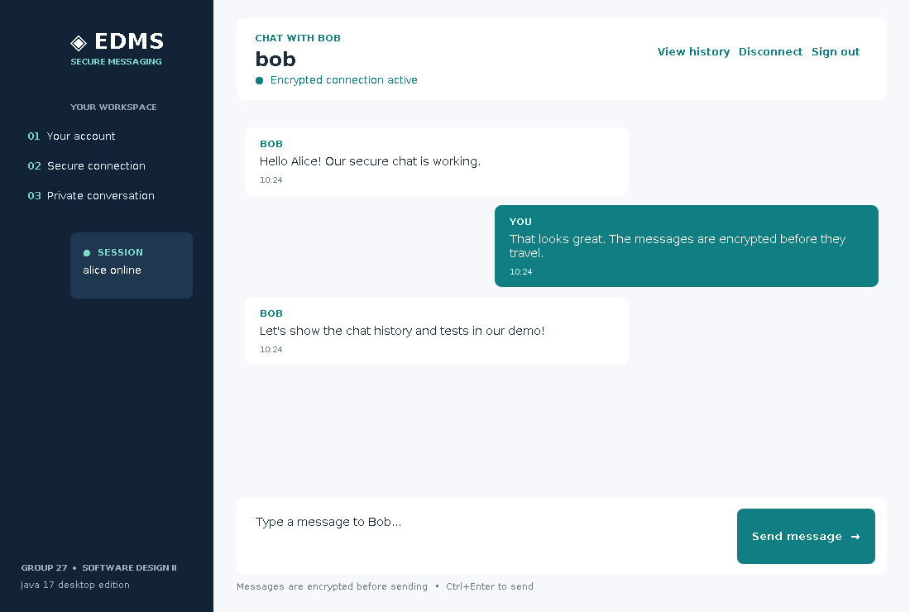
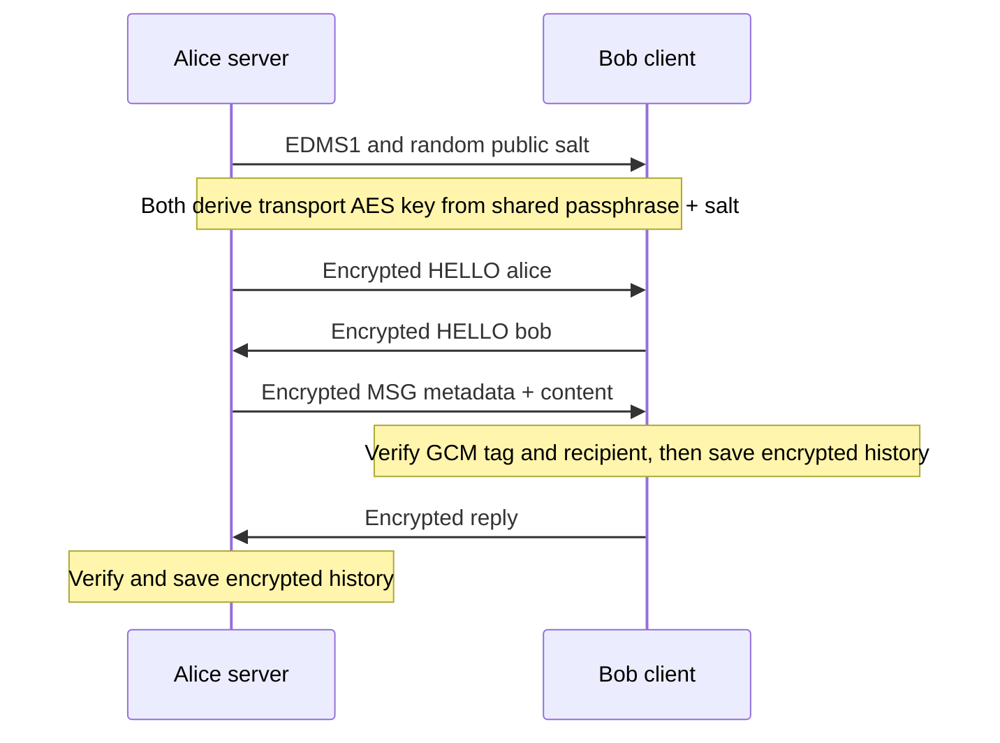
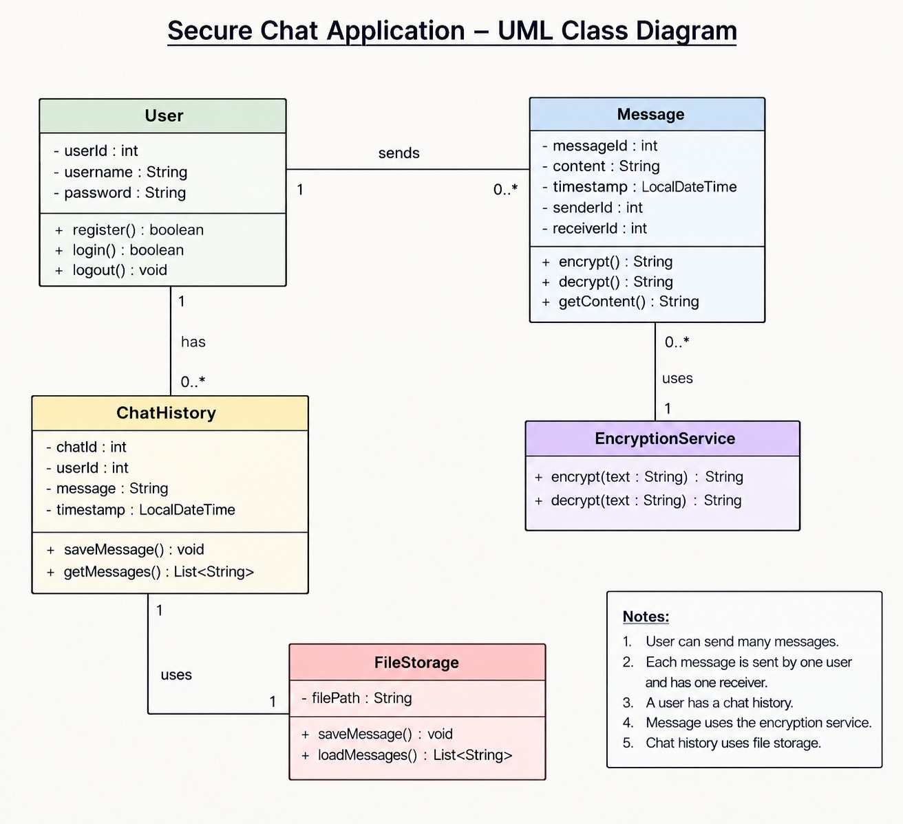

# Updated EDMS UML and Implementation Mapping

The supplied **Secure Chat Application — UML Class Diagram** describes five core concepts: `User`, `Message`, `ChatHistory`, `EncryptionService` and `FileStorage`. This update retains those concepts and adds the prototype's actual authentication, networking and logging responsibilities.

## Implementation-oriented class diagram

## Traceability from original UML

| Supplied UML concept | Actual class in `src/EdmsPrototype.java` | Notes |
|---|---|---|
| `User` | `User` and `AuthManager` | Registration/login deliberately delegated to a manager instead of a record model. Password is never stored directly; salted hash replaces `password : String`. |
| `Message` | `Message` | Unique identifier is `UUID`, time is `Instant`, participants are usernames for two-peer portability. AES work is delegated to `EncryptionService`. |
| `ChatHistory` | `ChatHistory` | One history facade belongs to each signed-in session. |
| `FileStorage` | `FileStorage` | Saves/loads per-user encrypted files rather than plaintext `List<String>` records. |
| `EncryptionService` | `EncryptionService` | Uses AES-256-GCM and PBKDF2-derived keys, replacing the original AES-ECB construction. |
| New support services | `NetworkManager`, `AuditLogger`, `Session` | Required by the prototype's socket workflow, audit events and login state. |
| New desktop UI | `EdmsGui` | Java Swing view/controller that reuses the original classes, messaging format and shared handshake. |

The Mermaid class diagram reflects the *implemented* Java structure. Method parameter types are abbreviated for readability; refer to source for exact Java signatures and exceptions.

## Desktop interface screen flow

This preview uses the same `ChatPanel` component as the running GUI. The pictured messages are illustrative only.

## Message exchange sequence

**Design boundary:** A user having the shared passphrase can claim a peer name in the encrypted hello; this is **not independent remote identity verification**. The key-salt header is public, passwords are local, and session keys are not a formal forward-secret key exchange.

## Supplied group diagram

Keep both the supplied image and this implementation diagram with the report. Explain intentional type/method changes if asked during the presentation.
