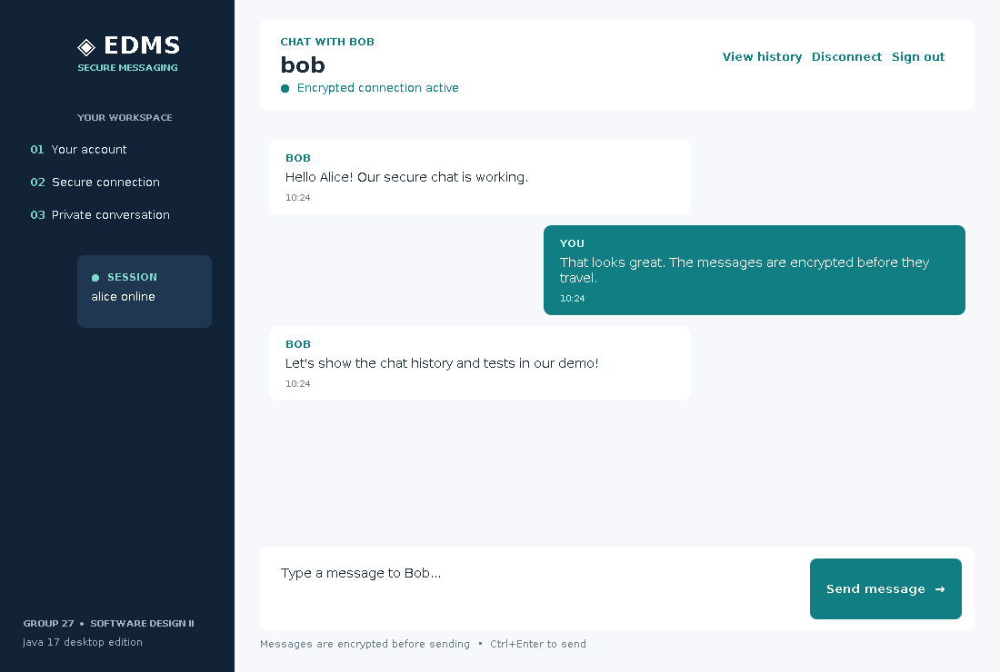

# EDMS User Guide — Desktop GUI and Console

## 1. System requirements

- Java Development Kit (JDK) 17 or newer, or a Java 17 runtime with the compiler module.
- Windows, macOS or Linux terminal, IntelliJ, NetBeans, or VS Code terminal.
- Two application windows on **the same computer** and an available localhost port (example `8888`).
- A desktop environment for Swing. The console version can still run without a graphical display.
- Keyboard/console access; the app prompts for account passwords and the chat passphrase.

## 2. Compile and verify

In the project directory, run `bash scripts/test.sh` (macOS/Linux/Git Bash) or use Java directly:

```text
javac -encoding UTF-8 -d out src/EdmsPrototype.java src/EdmsGui.java test/EdmsTests.java
java -cp out EdmsTests
```

On Windows PowerShell, create the output directory first if necessary:

```powershell
New-Item -ItemType Directory -Force out
javac -encoding UTF-8 -d out src\EdmsPrototype.java src\EdmsGui.java test\EdmsTests.java
java -cp out EdmsTests
```

Expected final line: `RESULT: 23 passed, 0 failed (23 cases)` when localhost socket access is permitted.

## 3. Graphical desktop version — recommended

Run the following command **twice**, once in each terminal. Each command opens its own Swing window:

```text
java -cp out EdmsGui --data demo-data
```

**Window A (server):** Click **Create an account**, register `alice` with an 8+ character password, or sign in if the account exists. On the next screen select **Start server**, keep port `8888`, enter your private shared chat passphrase (12+ characters) and click **Start listening**.

**Window B (client):** Register/sign in as `bob`. Choose **Join as client**, server address `localhost`, the same port `8888`, and **the same shared chat passphrase**. Click **Connect to peer**.

Once connected, the chat screen displays the peer's username, encrypted-connection status, scrollable message bubbles, a multiline composer and a **Send message** button. Use **Ctrl+Enter** to send from the keyboard; plain Enter adds a new line. Use **View history** to open encrypted local history, **Disconnect** to return to the connection screen, or **Sign out** to end your login.

The GUI and console use the same connection protocol. One window can use `EdmsGui` while the peer uses `EdmsPrototype` if both enter matching passphrases and usernames.

**NetBeans:** Open a Java project using JDK 17+, add `src/EdmsPrototype.java` and `src/EdmsGui.java` to its source package (default package), and set the main class to **`EdmsGui`**. Run a second project instance for the second peer. In a terminal you can also run the commands above, even if your IDE runs the first GUI window.



*The preview uses the real GUI layout with example messages. The actual GUI requires a desktop display.*

## 4. Console alternative — registration and login

1. Start the server terminal with `java -cp out EdmsPrototype --server 8888 --data demo-data`.
2. At the menu choose `1` (register) or `2` (login).
3. Usernames must be **3–20 lowercase characters**, start with a letter and then contain letters, digits or underscores. Example: `alice_1`.
4. Account passwords must be **8–128 characters**. The app never stores account passwords in plaintext.
5. Register or sign in. Supply a **shared chat passphrase (12+ characters)**. The server waits for the client.
6. In a second terminal, run `java -cp out EdmsPrototype --client localhost 8888 --data demo-data`.
7. Register `bob` or sign in. Supply exactly the same shared chat passphrase.
8. Both terminals display `Encrypted connection ready: alice <-> bob` (names reversed on Bob's screen).

For this **same-computer demo**, use the same `--data demo-data` path in both windows so that registered accounts are visible to both processes. Do not use the same account name in both windows. Password entry is hidden when Java has a proper interactive system console; in IDE input panels or redirected input it may remain visible.

## 5. Console messaging and commands

After connecting, type ordinary text and press Enter. Messages are limited to 2,000 Unicode code points; blank messages are rejected.

| Command | Action |
|---|---|
| Any normal text | Send encrypted message to connected peer |
| `/history` | Decrypt and list the signed-in user's saved sent/received messages |
| `/help` | Display available commands |
| `/quit` | Disconnect and log out |
| `/logout` | Same behaviour as `/quit` |

Incoming messages appear asynchronously with an ISO-8601 UTC timestamp and sender name. Text may appear near a prompt if the peer sends while you are typing; this is a minor console UI limitation.

## 6. Files and data privacy

- `demo-data/users.tsv`: usernames, numeric IDs, random salts and password-derived hashes (never plaintext passwords).
- `demo-data/history/alice.history`, `bob.history`: AES-GCM encrypted message records. History is derived from the signed-in user's account password and is therefore unreadable with a different password.
- `demo-data/logs/app.log` (and possibly numbered files): system events, excluding message bodies, passwords and shared passphrases.

If an account password is forgotten, there is no password recovery in this prototype. The account's old history cannot be decrypted. For a demonstration reset, make a **new data directory** instead of deleting personal data.

## 7. Common problems

| Symptom | Action |
|---|---|
| `Port must be 1-65535` | Supply a valid numeric port. |
| `Address already in use` | Close previous server or use a different port in both commands. |
| `Connection refused` | Start the server first, and check the same localhost port. |
| `Secure handshake failed` | Re-enter the same chat passphrase on both terminals; restart both processes. |
| `Username already registered` | Select login or choose a new valid username. |
| `Message rejected` | Avoid blank text or messages longer than 2,000 characters. |
| `unreadable/corrupt history record(s) skipped` | Some encrypted entries were damaged or created under a different key; usable entries remain visible. |
| Socket `Operation not permitted` during tests | The execution sandbox prohibits local ports; run on a normal local machine or authorized environment. |
| Swing window does not open (`HeadlessException`) | Launch the GUI on Windows/macOS/Linux with a desktop display; use the console mode on a headless server. |
| Connection screen appears frozen while waiting | It is listening in a background worker. Start the client window or click **Cancel waiting**. |

## 8. Suggested demonstration sequence

Show a failed login, a successful login, a message in both directions, `/history`, a too-long/blank message (validation), and `/quit`. Run `java -cp out EdmsTests` to show 20 checks. Explain that raw transport frames begin with `ENC|` and carry Base64-encoded AES-GCM ciphertext; no plaintext chat line is transmitted. Follow the step-by-step [Demo Script](DEMO_SCRIPT.md).
